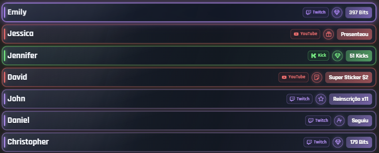

# Lista de Eventos Neon — Streamlabs v1.0 ✨

Widget visual para a **Lista de Eventos nativa do Streamlabs**, com barras compactas de vidro escuro, bordas neon, ícones de ações, identificação de plataformas quando possível e rótulos em português brasileiro. Pensado para uso em lives multistream.

> **Status:** o visual e algumas classificações de eventos foram conferidos em capturas de teste. A compatibilidade com todos os eventos reais ainda depende da disponibilidade, configuração e dados efetivamente entregues pelo Streamlabs. Projeto independente, não oficial.

## Recursos

- Layout horizontal compacto com fundo transparente ao redor dos cartões, acabamento de vidro escuro e neon nas bordas.
- Cores por plataforma: Twitch (roxo), YouTube (vermelho), Kick (verde) e Facebook (azul), quando a plataforma é identificável.
- Ícones SVG gerados pelo próprio código; sem necessidade de instalar pacotes.
- Textos de eventos em português, com preservação de quantidades e valores quando reconhecíveis.
- Efeitos de entrada, saída e pulso no evento recente, com suporte à preferência de movimento reduzido.
- Aproveita o histórico e a recepção de eventos da **Lista de Eventos nativa**; não cria uma conexão própria às APIs das plataformas.

## Instalação rápida

1. Abra o painel Streamlabs > **Lista de Eventos** e salve um backup das personalizações atuais.
2. Ative o modo de **HTML/CSS/JS personalizado** no tema da Lista de Eventos.
3. Cole o conteúdo de [`codigo/HTML.txt`](codigo/HTML.txt) na aba **HTML**.
4. Cole o conteúdo de [`codigo/CSS.txt`](codigo/CSS.txt) na aba **CSS**.
5. Cole o conteúdo de [`codigo/JavaScript.txt`](codigo/JavaScript.txt) na aba **JavaScript**.
6. Em **Eventos**, selecione os eventos desejados para cada plataforma conectada, ajuste o número máximo (recomendado: **5**) e salve.
7. Use a **URL do Widget** como fonte de navegador no OBS, ou a fonte correspondente no Streamlabs Desktop. Para começar, experimente **720 × 430 px** e ajuste à sua cena.
8. Clique em **Testar** no painel do Streamlabs e confirme as informações com eventos reais quando possível.

**Atenção:** use **Lista de Eventos**, e não o produto separado chamado **Custom Widget**. Colar esses arquivos em um HTML independente não fará os eventos reais chegarem automaticamente.

Para instruções e solução de problemas, consulte [`docs/INSTALACAO.md`](docs/INSTALACAO.md).

## Compatibilidade e eventos

O Streamlabs anuncia suporte multistream à Lista de Eventos e mais de 30 tipos de interações. A lista abaixo corresponde às opções observadas no painel enviado para o projeto e aos tipos tratados visualmente pelo código; não é uma garantia de que toda modalidade estará ativa ou de que a plataforma será identificada em todos os eventos.

| Origem | Exemplos de eventos contemplados | Observações |
| --- | --- | --- |
| **Twitch** | Seguidores, inscrições, reinscrições, presentes de inscrição, Bits, Power-Ups, doações beneficentes e raids | Bits identificáveis pelo tipo; eventos genéricos podem aparecer como `EVENTO` quando não houver origem explícita. |
| **YouTube** | Inscritos, membros, membros presenteados, reinscrições, Super Chat, Super Stickers, Jewel Gifts | Jewel Gifts pertencem ao YouTube, **não** à Kick. |
| **Kick** | Seguidores, inscrições, reinscrições, presentes de inscrição e Kicks | Kicks pertencem à Kick, **não** ao YouTube. Raids recebem visual de raid **se** o Streamlabs enviar o evento identificável. |
| **Facebook** | Seguidores, estrelas e outras interações reconhecíveis (curtidas/compartilhamentos) | Depende de disponibilidade na conta e nas configurações. |
| **Streamlabs / demais origens** | Doações e eventos genéricos | Algumas linhas podem usar identificação neutra `EVENTO`. |

**Raids na Kick:** a plataforma oferece raids, mas não há confirmação de que a **Lista de Eventos do Streamlabs** entregue todos esses eventos. O código está preparado para mostrá-los quando recebidos e identificados. **X (Twitter):** o Streamlabs cita a plataforma em sua página geral, porém esta versão não possui emblema dedicado ou validação específica para X; será exibido rótulo neutro quando não for possível identificar.

## Como funciona

O HTML preserva os tokens do template nativo (`{eventType}`, `{tag}`, `{from}`), o CSS estiliza as linhas e o JavaScript observa alterações na lista para traduzir rótulos e adicionar ícones. **A recepção, a filtragem, o armazenamento e a ordenação dos eventos continuam sob controle do Streamlabs.**

A ação é determinada pelo rótulo do evento; o nome da plataforma (`Kick`) não deve ser confundido com a contribuição (`Kicks`). Quando um tipo é característico de uma plataforma (por exemplo, `Kicks` ou `Bits`), a ação prevalece sobre uma indicação genérica conflitante. Para `Follow`, `Sub` ou `Raid`, o código exige uma indicação explícita da origem; não inventa uma plataforma.

## Testes e limitações

- ✅ Captura atualizada com eventos exibidos de Twitch, YouTube e Kick; inclui Bits, presente, Kicks, Super Sticker, reinscrição e seguidor.
- ✅ Testes locais anteriores de classificação e ausência de erros no ambiente simulado (não equivalem a teste de produção de todas as plataformas).
- ⏳ Validação real completa ainda pendente, especialmente **seguidores e raids da Kick** e demais interações de plataformas.
- ⚠️ Se o template não trouxer origem suficiente, o rótulo genérico **EVENTO** é intencional.
- ⚠️ Não inclui integração externa, login, tokens de API, captura de eventos independente ou garantia de suporte a todas as ações futuras.

Veja [`docs/TESTES.md`](docs/TESTES.md) para um checklist e como relatar problemas.

## Créditos e licença

**Projeto e identidade visual:** Guia do Streamer / Guia Leo. **Implementação:** desenvolvimento colaborativo com auxílio do ChatGPT (OpenAI), a partir da personalização da Lista de Eventos do Streamlabs. A Streamlabs e os nomes/logotipos de plataformas são marcas de seus respectivos titulares; este projeto é independente e não possui vínculo oficial com elas.

**Licença proposta:** MIT — veja [`LICENSE`](LICENSE). Antes de publicar, confirme que o nome indicado nos créditos é o desejado e que você concorda em disponibilizar o código sob MIT.

## Referências oficiais

- [Streamlabs — Lista de Eventos](https://streamlabs.com/pt-br/stream-widgets/event-list)
- [Streamlabs — Configuração da Lista de Eventos](https://support.streamlabs.com/hc/en-us/articles/360052471593-Event-List-Widget-Setup)
- [Streamlabs — Gerenciamento de contas vinculadas](https://support.streamlabs.com/hc/en-us/articles/360009822154-How-to-Manage-Multiple-Linked-Accounts)
- [Streamlabs — Introdução aos Custom Widgets](https://streamlabs.com/content-hub/post/how-to-get-started-with-streamlabs-custom-widgets) *(documentação de outro tipo de widget; útil como referência de eventos, mas não comprova o payload desta Lista de Eventos).* 

